# 🍛 Taste of Tamil Nadu — Mobile App

A mobile app for *Taste of Tamil Nadu*, an authentic South Indian restaurant. It is built to work on both Android and iPhone from one codebase.

---

## 📱 Screenshots

<table>
  <tr>
    <td align="center">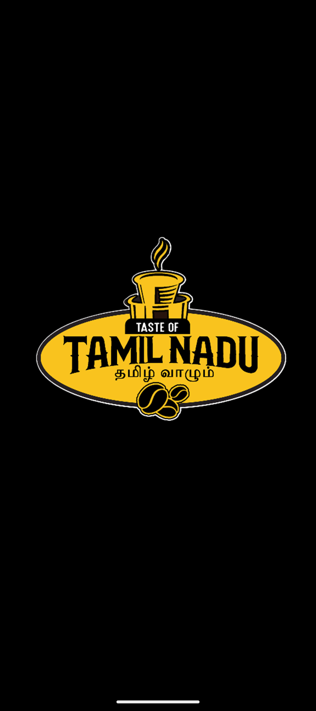 <b>Splash</b> Restaurant logo shown on launch</td>
    <td align="center">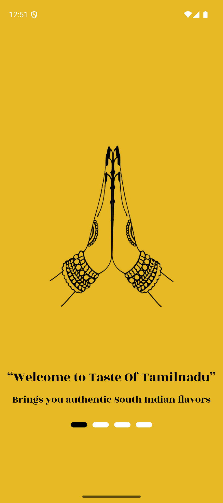 <b>Welcome</b> Introduction to the restaurant</td>
    <td align="center">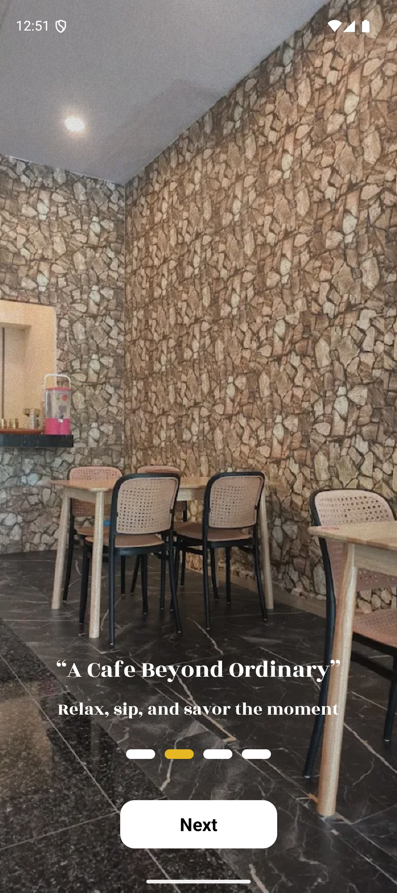 <b>A Cafe Beyond Ordinary</b> "Relax, sip, and savor the moment"</td>
  </tr>
  <tr>
    <td align="center">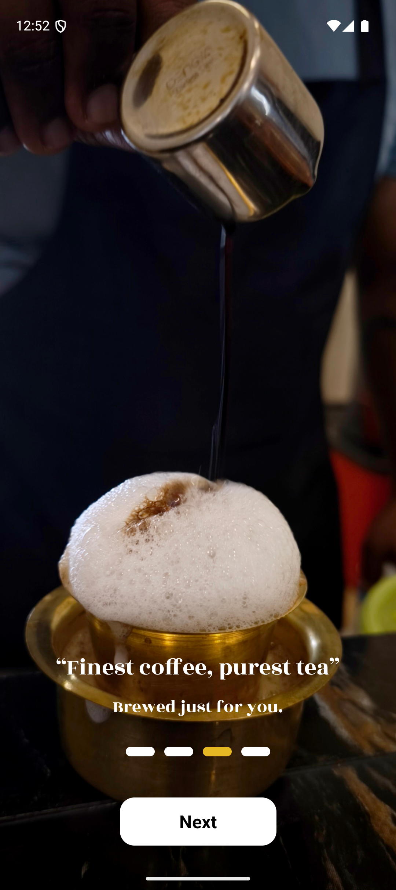 <b>Finest Coffee, Purest Tea</b> "Brewed just for you"</td>
    <td align="center">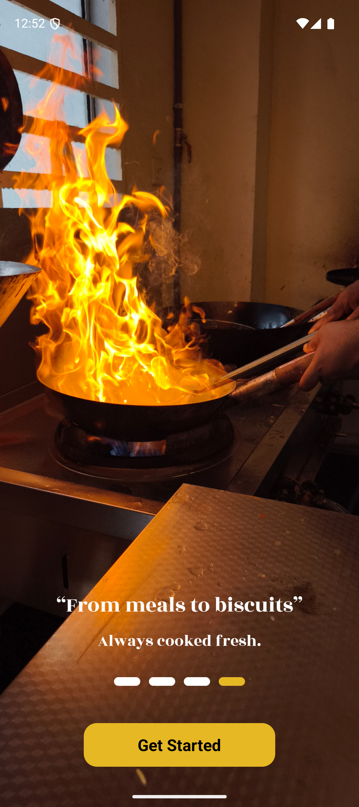 <b>From Meals to Biscuits</b> "Always cooked fresh"</td>
    <td align="center">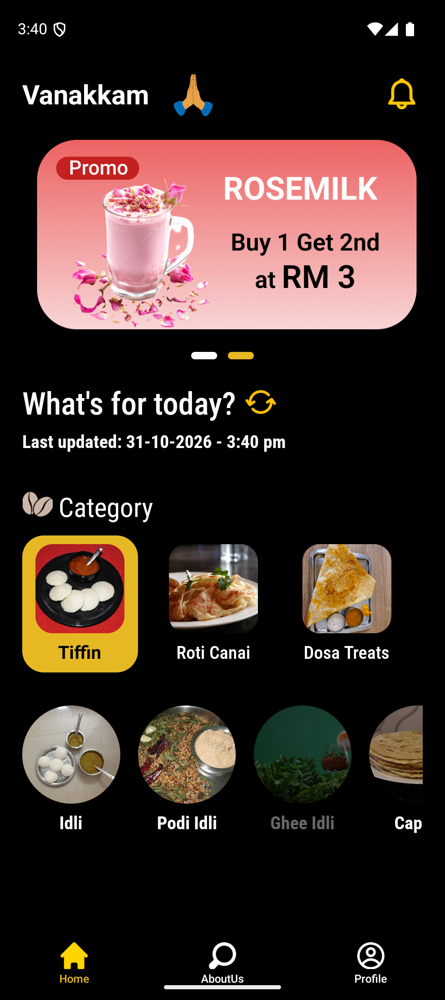 <b>Home</b> Promotions, menu categories and dish photos</td>
  </tr>
</table>

<table>
  <tr>
    <td align="center">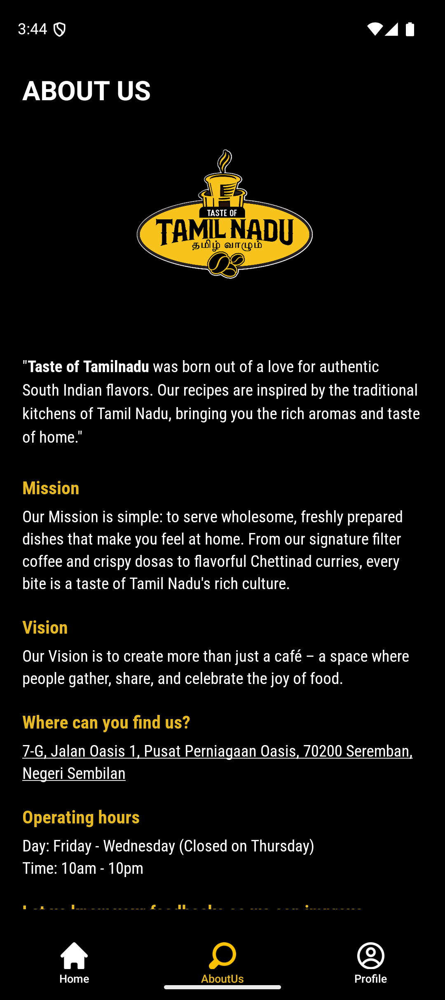 <b>About Us</b> Story, mission, vision and opening hours</td>
    <td align="center">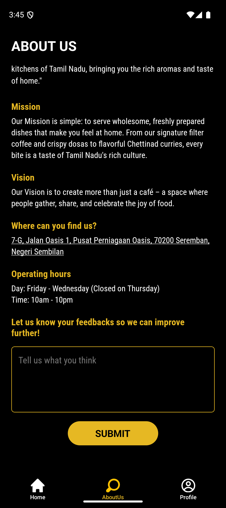 <b>Feedback</b> Guests share feedback after logging in</td>
    <td align="center">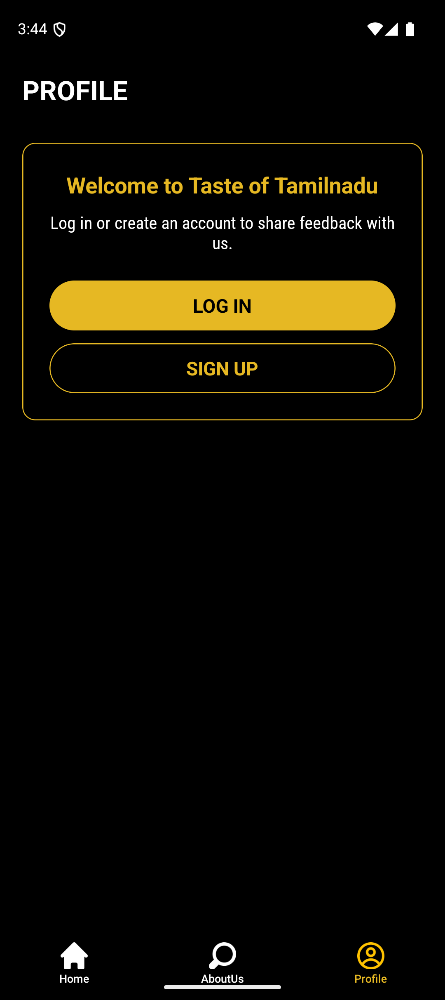 <b>Profile</b> Log in or sign up to join in</td>
  </tr>
  <tr>
    <td align="center">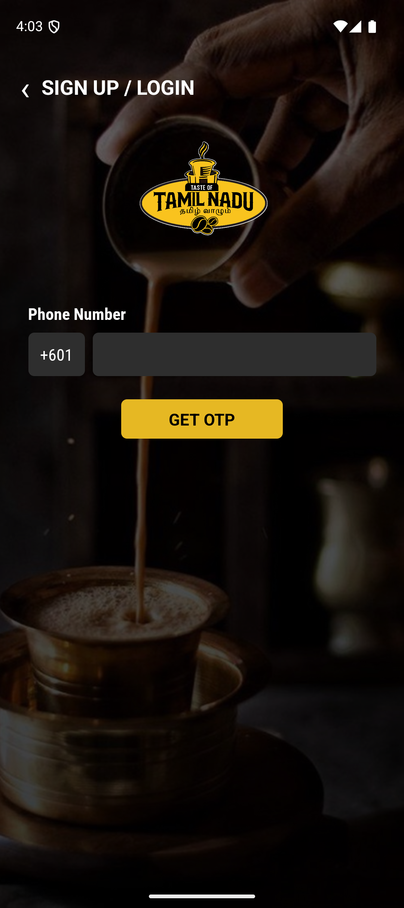 <b>Sign Up / Login</b> Enter a phone number</td>
    <td align="center">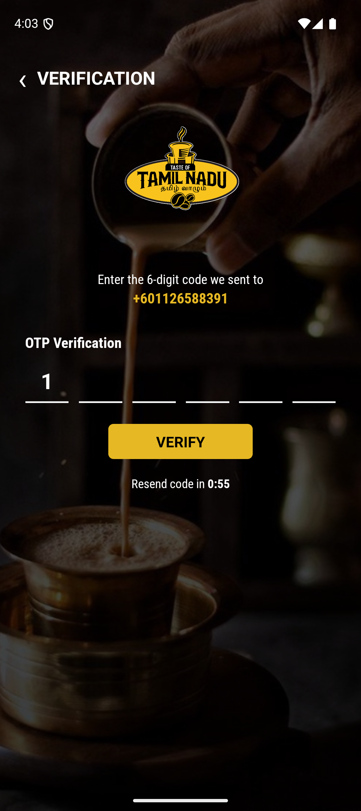 <b>Verification</b> Enter the 6-digit code</td>
    <td align="center">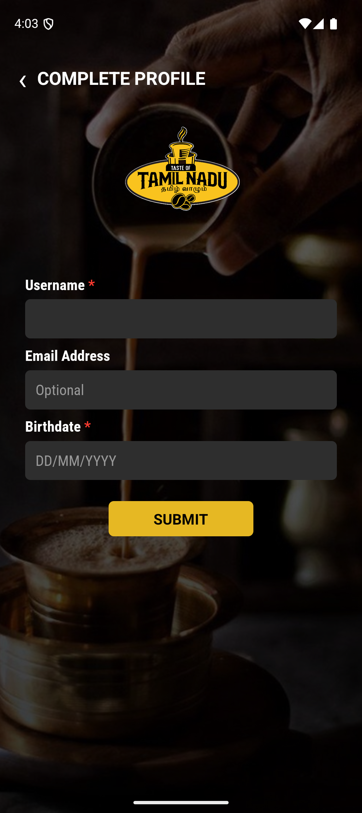 <b>Complete Profile</b> Username, optional email and birthdate</td>
  </tr>
</table>

---

## ✨ What the App Does

* **Welcome walkthrough:** Four intro slides introduce the restaurant. Users can swipe or tap **Next**, then **Get Started** to enter the app.
* **Home screen:** A friendly *Vanakkam* greeting, a "What's for today?" section showing when it was last updated, and pull-to-refresh to reload.
* **Promotions banner:** Promotional images are built into the app and appear as a swipeable banner.
* **Menu categories:** Four categories (Tiffin, Roti Canai, Dosa Treats, Chicken), each with its own dishes and photos. Dishes that are sold out appear faded.
* **About Us:** The restaurant's story, mission, vision, address (tap to open in Maps), opening hours, and a feedback form.
* **Profile:** Log in or sign up, or view your details and log out.
* **Easy navigation:** Three tabs at the bottom: **Home**, **About Us**, and **Profile**.

---

## 🚧 Current Status

This is an early version of the app, and some parts are still placeholders:

* **Menu:** The categories and dishes are sample content. Dish names and prices will be updated once the restaurant's real menu is confirmed. Photos are from free-license sources (see the credits file in the app project).
* **Accounts:** Sign up and login use a phone number and a verification code. The code is not checked yet, and no SMS is sent, so any code works. Accounts are not saved between app launches.
* **Feedback:** Logged-in guests can send feedback from the About Us tab, but feedback is not stored yet. It shows a thank-you message after submitting.

> **Note on project status:** This app was built as a client product for the *Taste of Tamil Nadu* restaurant. After the restaurant's physical business closed, this repository was kept as a showcase of the app's design and mobile engineering work.

---

## 🛠️ Built With

* **React Native** and **TypeScript** for the app
* **Wikimedia Commons** photos for the menu (free-license, credited)
* **Android and iOS** native projects

For setup steps, versions, and architecture details, see [TECHNICAL_NOTES.md](TECHNICAL_NOTES.md).

---

## 👤 Developer

* **Developer:** Gokul Nath ([@GokulNath20](https://github.com/GokulNath20))
* **Role:** Mobile Application Developer (React Native & Native Tooling)
